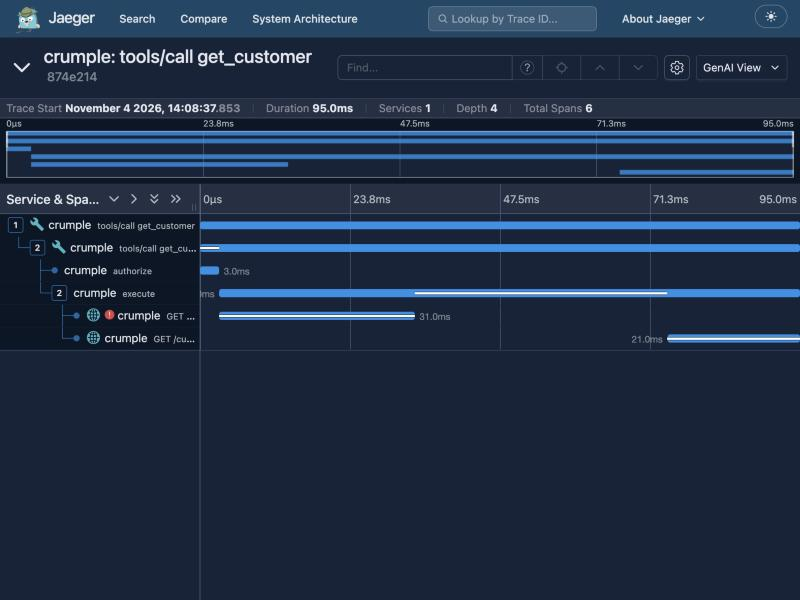

# `telemetry`: what happened, without leaking it

Spec: [SPEC-telemetry.md](../../SPEC-telemetry.md). Code: [src/telemetry/](../../src/telemetry/).

## The one-sentence version

A small tracer that records each call's journey in the standard format, built so that secrets and customer data
have no way in.

## What a trace shows

That's a hand-written sample sent to a real Jaeger, not a measurement. Read it top to bottom: the agent's call, the server's
matching span, the permission check, the execution, a first attempt that failed with a 503 (the red mark), then a
gap (the backoff), then a retry that worked. One picture answers "why was this call slow?", and that's what traces are for.

The agent's span and the server's share one trace id, even though they're separate programs. The id travels in `traceparent`, in the
MCP message's `_meta` field, by OpenTelemetry's convention. **The server can't see tokens,** because they belong to the model call. So the
agent records them, and the shared trace id joins the two sides.

## The decision an interviewer will ask about

**"Why write your own instead of using the OpenTelemetry SDK?"**

Because this is a package people install with `npx`, where install size is the first impression, and runtime dependencies are capped at two.
And we only need three things: nested spans, W3C trace context and OTLP output. **The output is standard OTLP, so users lose nothing:** Jaeger, Tempo
and Honeycomb all read it. We give up auto-instrumentation and sampling.

The honest second half: **inside a company's service, I'd use the SDK.** The reason it's different here is the distribution, not that the SDK is bad.

## The security idea: an allowlist, not a scrubber

The usual approach is to record everything, then scrub what looks secret. That fails open: the next secret nobody thought of goes straight through.
Here it's reversed. **Only attributes on one list can be recorded,** and everything else is dropped and counted. In tests it throws, so a developer finds out immediately.

So these can't be recorded, by construction and not by discipline:

- **Tool arguments and results.** OpenTelemetry makes them opt-in, and you decided there's no opt-in at all. A debugging flag that leaks customer data is how these
  incidents happen.
- **Real URLs.** A trace holds `/customers/{id}`, never `/customers/cus_1`, because a path can name a customer.
- **Upstream error text,** which can repeat anything, including the credential. `error.type` is a short code from our own list.

Some allowed values come from outside, such as a request id, so values get a second defence. They're capped at 256 characters, and any value containing a
registered secret is replaced whole. Secrets are checked **before** capping, because a cap could cut one in half, and half a secret wouldn't match.

## Telemetry can't hurt a call

A collector that's down loses spans and counts the loss. Its errors never reach a caller, and a hanging one doesn't make a span wait. The rule behind it: observability exists to
serve the system, so it must never be the reason the system fails.

And **nothing is sent anywhere by default.** Exporting goes only to an address the user typed, which is how "never send telemetry" and an OTLP exporter can both be true.

## Honest limits

- **No sampling.** Every span is recorded, and it's the first thing a high-traffic service would need.
- **The conventions are marked Development,** so they can change. All names live in one file, so a rename is one edit.
- **In memory, audit events last only as long as the process.** The `cli` spec covers saving them.
- **Percentiles from the histogram are estimates,** because a histogram only knows which bucket a value fell in.

## Where to look

[attributes.ts](../../src/telemetry/attributes.ts) is the allowlist, and worth reading on its own. [span.ts](../../src/telemetry/span.ts) has the cleaning rules. [otlp.ts](../../src/telemetry/otlp.ts) is the
export, checked against OpenTelemetry's official example and, once, a real Jaeger.

## Teach-back

1. Someone says "just log the tool arguments, it'd make debugging easier". What do you say, and how do you debug without them?
2. Why is an allowlist safer than scrubbing secrets out? What does it cost you?
3. How can a trace span two separate programs? Where does the id travel?
4. An MCP server can't see token counts. Why not, and how does this project report them anyway?
5. **Where would you change this?** "We want to record which region served each request." Which file changes, and what do you check first about
   the value before allowing it?
